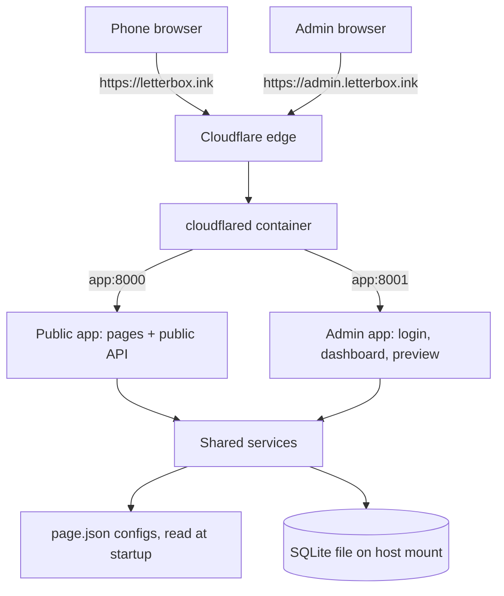

# Architecture

## Goals and constraints

- Single admin, very low traffic. Smallest reasonable footprint and upkeep.
- Runs as one Docker container alongside unrelated sites on a shared server.
- The platform stays minimal. Complexity is allowed only inside an individual
  page, and only when that page needs it.
- Published links are permanent: adding or changing pages must never break an
  existing link or lose its saved data.
- No visitor accounts and no third-party services.

## Stack

| Layer | Choice | Notes |
| --- | --- | --- |
| Backend | Python, FastAPI, Pydantic | API, validation, admin, file serving |
| Database | SQLite via stdlib `sqlite3` | Two small tables; numbered SQL migrations via `PRAGMA user_version` |
| Frontend | Vite (multi-page), React, TypeScript | One build entry per page |
| Styling | CSS modules | Each page owns its look |
| Admin UI | Server-rendered Jinja2 templates | No separate build |
| QR codes | `segno` | Pure Python, PNG and SVG |
| Runtime | One multi-stage Docker image, Docker Compose | Node only in the build stage; built for `linux/arm64` |
| Public access | Cloudflare Tunnel (`cloudflared` container) | No host ports published on the server; image pinned by digest |
| Tests | pytest; Vitest + Testing Library for shared client code | Not shipped in the image |

Pin dependency versions (lockfiles) when code is added. Animation, 3D or
media libraries are added only when a page needs them and are bundled only
into that page.

### Decisions

- **One directory per page, link stored in its config.** A page's code, assets
  and `page.json` (including its secret slug) live together. There is no
  registration step and no link table. This requires the repository to stay
  private.
- **Each page is a separate build entry.** The server returns a page's HTML
  only for its exact slug, and build assets have content-hashed names, so
  nothing served publicly lists or links other pages.
- **Static build, no Node server.** Pages are private and `noindex`; server
  rendering adds nothing.
- **Two listeners.** One process runs a *public* app and an *admin* app on
  separate ports. Admin routes are never mounted on the public app. The
  tunnel maps `letterbox.ink` and `admin.letterbox.ink` to them.
- **Own tunnel.** The Compose project carries its own `cloudflared` container,
  so it shares nothing with other stacks on the server.
- **Build once, deploy by digest.** GitHub Actions builds the arm64 image,
  publishes it privately to GHCR. A separate manual action deploys that exact
  digest over SSH.
  The server receives only Compose/runtime files and never builds source.
- **No ORM.** Two small tables do not justify SQLAlchemy and Alembic.
- **Last write wins.** No revision counter; pages have a single visitor.
- **No PostgreSQL, Redis, queues, object storage or background jobs.**

## Runtime topology



- `GET /l/<slug>` returns that page's HTML. Any unknown or disabled link
  redirects to the site root, which shows only a neutral "Nothing here"
  message. The page then calls the public API to load saved state and report
  that it was opened.
- The admin app serves the same page HTML at `/view/<page>` in read-only
  admin mode, which never counts as an open.

## Repository layout

```text
backend/
  app/
    main.py           # builds public_app and admin_app
    api/              # public and health routes
    admin/            # login, dashboard, preview, reset, QR, templates
    services/         # page configs, state, validation
    db/               # connection, pragmas, migration runner
  migrations/         # numbered .sql files
  tests/
frontend/
  pages/<name>/       # one directory per page
    page.json         # slug, title, fields, options
    index.html        # build entry
    main.tsx          # mounts the page
    Page.tsx          # page code and styles
    assets/           # images, audio, video for this page
  pages/_template/    # scaffold copied by new-page; not built
  shared/             # API client, PageRoot, base styles, tests
scripts/              # run, restart, dev, test, new-page, export-db
.github/workflows/    # pull-request tests; image release and SSH deployment
docs/
data/                 # SQLite file (gitignored)
```

`Dockerfile`, `docker-compose.yml` and tool config are added in Phase 1.

## Pages

- The directory name is the page's permanent internal id; the `slug` in
  `page.json` is its permanent public link. Neither changes after a link has
  been handed out.
- The build writes each page's `page.json` next to its built HTML. The
  backend loads them from the build output at startup and refuses to start on
  a duplicate or too-short slug or an invalid field definition. `page.json`
  is never served.
- `scripts/new-page.sh <name> <link-words>` copies the template into a new
  directory and writes the chosen slug into its `page.json`.
- Pages are independent. Shared code in `frontend/shared/` must stay backward
  compatible; a page that needs different behaviour keeps its own copy.

## Security and privacy rules

- The slug is the only access control for a page. It is chosen by the admin
  as readable hyphenated words, so its strength depends on how many and how
  unusual the words are; anyone who knows or guesses it can open the page.
  This trade-off is accepted (see the decision log). Unexpected opens are
  visible in the open log, and a link can be blocked at the edge at any time.
- Unknown and disabled slugs behave identically: a redirect to the site root,
  which shows a neutral "Nothing here" message and nothing else.
- GET requests never change state. Opens are recorded through an explicit
  request made by the page's script.
- Stored per page: submitted values, and for each open its timestamp,
  navigation type, visitor timezone and approximate city-level location
  from Cloudflare; the
  first open doubles as "received". No IP addresses, coordinates or user
  agents.
- Mutations require a matching `Origin` and a JSON body; no permissive CORS.
- Validate field names, types, options, lengths and body size server-side.
  Render submitted text as text only.
- Response headers: `X-Robots-Tag: noindex, nofollow`,
  `Referrer-Policy: no-referrer` (admin: `same-origin`), `Cache-Control: no-store` on HTML and API,
  a restrictive CSP and `frame-ancestors 'none'`. Hashed assets may be cached.
- No third-party scripts, fonts or trackers.
- Admin: single scrypt-hashed password, signed 12-hour session cookie
  (`HttpOnly`, `Secure` in production, `SameSite=Strict`), globally throttled
  login attempts and same-origin form mutations.
- Logs must not contain slug-bearing paths or response bodies.
- Forwarded headers are not trusted or needed: production-only behaviour comes
  from `APP_ENV`, origin checks compare hosts, and login throttling is global.
- API docs (`/docs`, `/openapi.json`) are disabled on both apps.
- `.env`, the database and generated QR codes are never committed. Tests and
  demo pages use synthetic content only.
